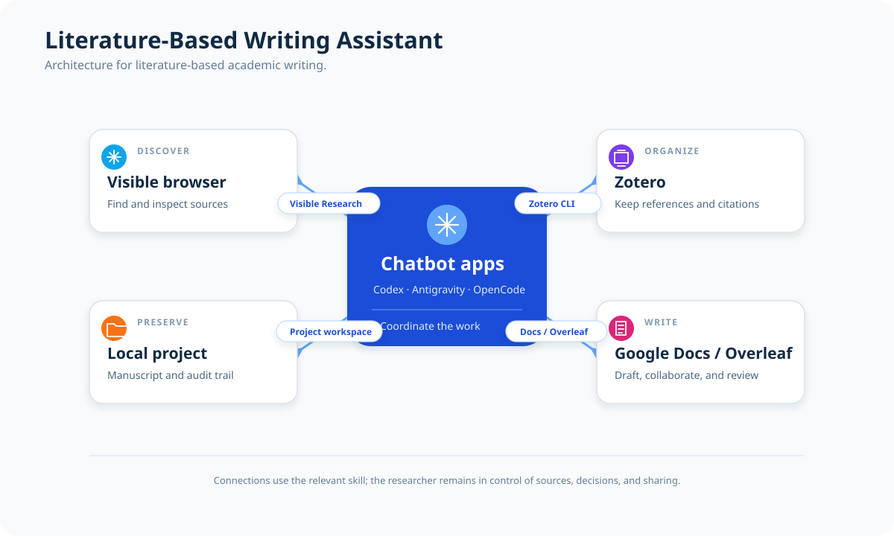

# Literature-Based Writing Assistant

A credential-free, researcher-controlled assistant for literature-based
academic writing. It connects visible browser research, a local Zotero library,
project files, and Google Docs or Overleaf.

It intentionally versions the workflow, not private state: no API keys,
browser cookies, Zotero library data, or machine-specific Chrome ports belong
in this repository.

## Why use this alongside Deep Research?

General-purpose Deep Research is useful for quickly discovering and
synthesizing public material. This workflow is designed for the next stage:
building a reviewable manuscript from sources that a researcher has actually
examined. It keeps a person in control at the points where access,
provenance, and manuscript correctness matter.

- **Access through your own visible browser.** A signed-in local browser can
  reach material available through an institutional VPN, library proxy, or
  other access that a hosted research service cannot use. You can see which
  sites and documents are opened, complete a CAPTCHA or other human
  verification yourself, and decide what the assistant may read. Credentials
  and browser profiles remain local.
- **A durable, searchable source record.** Confirmed papers, metadata, PDFs,
  notes, and tags can be organized in Zotero rather than living only in a
  chat transcript. That library remains useful for later manual or automated
  analysis, and gives each manuscript reference an inspectable source record.
- **Citation handling that survives revision.** Zotero is the bibliographic
  source of truth, while the bibliography guard preserves citation keys
  already used by the manuscript and dry-runs merges before writing them.
  LaTeX/BibLaTeX regenerates citation order and formatting when the document
  changes, avoiding the fragile manual renumbering common in Word-based
  workflows. This improves traceability and reduces avoidable reference
  errors; it does not replace checking every cited claim.
- **Live, collaborative manuscript production.** Overleaf makes the LaTeX
  source available for direct collaboration and discussion with coauthors.
  The editing workflow reads changes back, compiles the project, and checks
  the resulting PDF and log, so a citation or formatting change is verified
  in the document people will actually review.
- **An auditable handoff.** Versioned source, notes, plans, and a concise
  research log make it possible for a coauthor or another agent to retrace
  searches, decisions, and evidence instead of relying on a one-off generated
  answer.

The goal is not to replace Deep Research, but to pair broad discovery with a
transparent, researcher-controlled path from source access to a collaborative,
compile-verified manuscript.

This template does not bundle a Deep Research skill. You may add an
open-source Deep Research skill set for discovery, search planning, or
literature synthesis, then use this workflow to inspect the selected sources
in the visible browser, save confirmed records to Zotero, and incorporate
citations into Overleaf. Treat externally generated references as leads to
verify, rather than importing them into a manuscript unchecked.

## How the architecture fits together

This setup brings agents, skills, and research tools together to support
literature-based writing. It can reduce manual work—such as navigating search
results, organizing sources, and identifying papers for review—so you can focus
on evaluating the literature, developing ideas, and writing. Zotero remains the
source of truth for references; browser profiles and credentials stay local.

### Limits and required human checks

This workflow makes a *fabricated* reference much less likely when every
manuscript item is selected from a Zotero record that you have inspected: the
bibliography is generated from those records, rather than invented by a model
while drafting. It is not a guarantee that every reference or claim is
correct. Before relying on a citation, check the source landing page, DOI or
other persistent identifier, authorship, publication version, and (where it
matters) the full text. Also check that the cited source actually supports the
nearby claim.

Possible failures still include an incorrect or incomplete metadata import, a
confusion between similarly titled papers or preprint and final versions, a
real paper cited for a claim it does not support, or a manually edited `.bib`
file that bypasses the guard. The model and its instructions still matter:
stronger models and explicit source-checking prompts can reduce these errors,
but neither removes the need for human judgment. Keep the visible-browser,
Zotero-confirmation, and compile-review checkpoints in the workflow, and
report or correct any uncertain source before sharing the manuscript.

## What it provides

- `.agents/agents/literature-based-writing-assistant/AGENT.md`: the shared
  Literature-Based Writing Assistant definition, with Codex, Claude, Gemini, and
  OpenCode entry points.
- `AGENTS.md`: project instructions for research, Overleaf, and Zotero work.
- `.agents/skills/visible-research-cdp`: visible Chrome/CDP workflow for
  public literature searches and user-completed site verification.
- `.agents/skills/zotero-cli`: saves each confirmed relevant paper to Zotero
  before citation or bibliography work.
- `.agents/skills/zotero-cli/scripts/sync_zotero_bibliography.py`: merges Local API BibLaTeX exports
  without changing established citation keys; its self-contained test ships
  alongside it.
- `.agents/skills/overleaf-cdp`: a bounded, compile-verified Overleaf editing
  workflow.
- `.codex/config.toml.example`: Chrome DevTools MCP configuration, with no
  credentials.
- Direct Zotero CLI guidance: the Zotero workflow does not require an MCP
  server configuration.
- `.agents/scripts/start-research-chrome.sh`, `-linux.sh`, `.ps1`, and `.cmd`:
  separate Chrome profiles for macOS, Linux, and Windows CDP work.
- `.agents/requirements-pdf-extraction.txt`: the Docling dependency declaration
  used by the PDF converter.
- `CHATBOT_SETUP_PROMPT.md`: a platform-neutral setup prompt to paste into
  Codex or OpenCode after creating a project from this template.

## Get started

1. Create a project with **Use this template**, or download the ZIP and open
   the folder in Codex, OpenCode, or another supported assistant.
2. Tell the assistant what you are writing and what you need—for example,
   “Help me find and screen relevant literature for the following paragraph.”
3. The assistant will guide any one-time setup and carry out the project
   workflow. It will ask when it needs your choice, permission, or review.

You do not need to run the project commands yourself. The agent instructions
handle browser research, Zotero, PDF text extraction, bibliography updates, and
Google Docs or Overleaf workflows.

Keep your manuscript and `references.bib` at the project root, and keep notes
in `notes/`. Treat `.agents/` as template infrastructure. See
[`WORKSPACE_LAYOUT.md`](WORKSPACE_LAYOUT.md) only when you need the complete
file-layout reference.

## Your role

The assistant can help search, organize, and screen literature, but you decide
which sources and claims belong in the work. Review sources and citations before
sharing a manuscript, and approve any requested access or Zotero changes.

## Publishing

Publish this folder as the root of a dedicated repository if you want to share
the project. Choose a license before publishing; local browser profiles,
credentials, and configuration stay out of Git.
